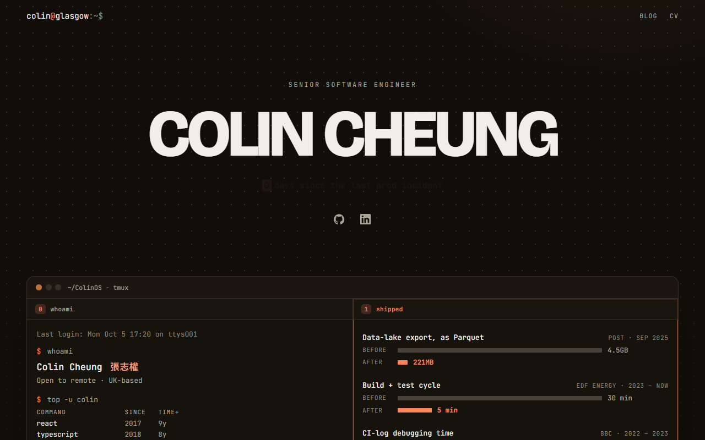

<div align="center">

# colincheung.dev

**A terminal-native personal site and engineering blog.**

**▶ Live: [colincheung.dev](https://colincheung.dev)** · [Blog](https://colincheung.dev/blog) · [CV](https://colincheung.dev/cv)

[](https://github.com/ColinCee/astro-blog/actions/workflows/deploy.yml?query=branch%3Amain)
[](https://colincheung.dev)



</div>

## What it does

- Terminal-inspired homepage built around a tmux-style window with live project tiles
- Technical blog written in MDX, with figure components and Expressive Code blocks
- Printable CV page that prints clean to ink-on-white
- Light and dark themes that follow the system setting
- Sitemap generated at build time

## Stack

| Area | Tooling |
| --- | --- |
| Framework | Astro 7 (static), TypeScript 6 |
| Content | MDX content collections; figures as Astro components |
| Code blocks | Astro Expressive Code |
| Styling | Custom CSS tokens in `src/styles/tokens.css`; scoped styles beside each component |
| Hosting | Cloudflare Workers |
| Deploys | GitHub Actions + Wrangler |
| Tooling | Node 24 LTS (pinned with Volta), pnpm, Biome (lint and format), Playwright |

## Run locally

```sh
pnpm install
pnpm dev
```

Node and pnpm versions are pinned in `package.json` (`volta`, `packageManager`).

## How it works

Astro builds the pages in `src/pages/` and the posts in `src/content/blog/`, styled with a small custom design system, into a fully static site. Wrangler uploads `dist/` to Cloudflare as an assets-only Worker (`wrangler.json`); there is no server code. [DESIGN.md](DESIGN.md) owns the visual system and [PRODUCT.md](PRODUCT.md) the audience and purpose.

## Project structure

```text
src/pages/             Routes: index.astro composes the homepage; blog/, cv.astro, cortex/
src/layouts/           Base (the shell: head, nav, footer) and Post (a post, inside Base)
src/components/site/   Head, Nav, Footer: the parts every page shares
src/components/home/   The homepage's sections: Hero, Terminal and its panes, WorkedAt, Projects, Writing, Reach
src/components/figures/ The posts' figures (Fig, Cmp, Dots, LineChart, Ladder, QView, …), each with its CSS beside it
src/content/blog/      The posts, one MDX file each
src/data/              The homepage's data as JSON: projects, companies, shipped, skills, homelab stacks
src/content.config.ts  The collections and their schemas: blog, plus one per data file
src/styles/            tokens.css (colours, type, widths) and prose.css (post text)
src/scripts/           Browser scripts shared between components, and the post figures' widgets
public/                Static files copied into the build as they are
```

## Commands

| Command | Action |
| --- | --- |
| `pnpm install` | Install dependencies |
| `pnpm dev` | Start the local dev server |
| `pnpm build` | Build the production site |
| `pnpm check` | Type-check (`astro check`), lint and format check (Biome), build, Wrangler dry run, then the tests |
| `pnpm format` | Lint-fix and format with Biome (posts and docs are left alone) |
| `pnpm run deploy` | Build and deploy to Cloudflare Workers (`pnpm deploy` is a pnpm command of its own) |
| `pnpm test` | Run the Playwright layout and typography tests; they start their own dev server on `PORT` (default 4380) |

## Deployment

Pushes to `main` run `.github/workflows/deploy.yml`, which installs dependencies, type-checks, lints and checks formatting, builds the site, validates the Wrangler config, runs the tests, and deploys with Cloudflare secrets. Pull requests run the same steps without the deploy.

Required repository secrets:

```text
CLOUDFLARE_ACCOUNT_ID
CLOUDFLARE_API_TOKEN
```
