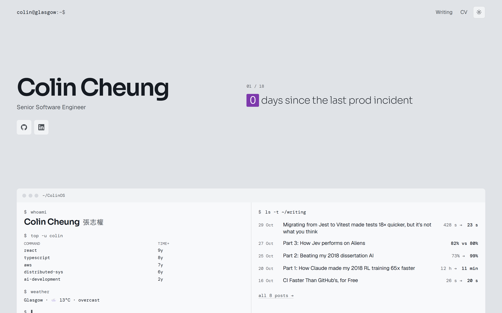

<div align="center">

# colincheung.dev

A terminal-flavoured personal site and engineering blog.<br>
Static, fast, and every post leads with the number it's about.

[**Site**](https://colincheung.dev) · [**Writing**](https://colincheung.dev/blog) · [**CV**](https://colincheung.dev/cv)

[](https://github.com/ColinCee/astro-blog/actions/workflows/deploy.yml?query=branch%3Amain)


<picture>
  <source media="(prefers-color-scheme: dark)" srcset="docs/readme-dark.png">
  
</picture>

</div>

## Inside

- **Homepage:** a terminal that types `whoami`, lists the latest posts with their results, and shows live figures from the home lab.
- **Writing:** MDX posts with figures that draw themselves in, and code blocks themed to match.
- **CV:** one page that prints clean on white.
- **Dark first**, with a light theme a click away.
- **Held to a speed budget:** every pull request fails if a page gets heavier or slower ([how](docs/page-speed.md)).

## Run it

```sh
pnpm install
pnpm exec playwright install chromium   # once, for the tests
pnpm dev                                # http://localhost:4321
pnpm check                              # everything CI runs
```

Node and pnpm versions are pinned in `package.json`.

<details>
<summary><b>All commands</b></summary>

| Command | Does |
| --- | --- |
| `pnpm build` | Build the static site into `dist/` |
| `pnpm test` | The Playwright tests (layout, type, motion, home lab) on a dev server |
| `pnpm speed` | Build, then the per-page speed budgets |
| `pnpm preview` | Build, then serve it through the Worker locally |
| `pnpm format` | Lint-fix and format with Biome |
| `pnpm og` | Render each post's social card |
| `pnpm run deploy` | Build and deploy to Cloudflare |

</details>

## How it fits together

```text
src/pages/        routes: home, blog/, cv
src/content/blog/ the posts, one MDX file each
src/components/   site/ (head, nav, footer) · home/ · figures/ · cv/
src/styles/       tokens.css, the design system's colours, type and motion
worker/index.ts   one route, /homelab.json, for the home lab's live numbers
```

Astro builds everything to static files; a Cloudflare Worker serves them. Pushes to `main` deploy through GitHub Actions after the same checks pull requests run, with the `CLOUDFLARE_API_TOKEN` and `CLOUDFLARE_ACCOUNT_ID` secrets.

[DESIGN.md](DESIGN.md) holds the visual system and [PRODUCT.md](PRODUCT.md) who it's for.
